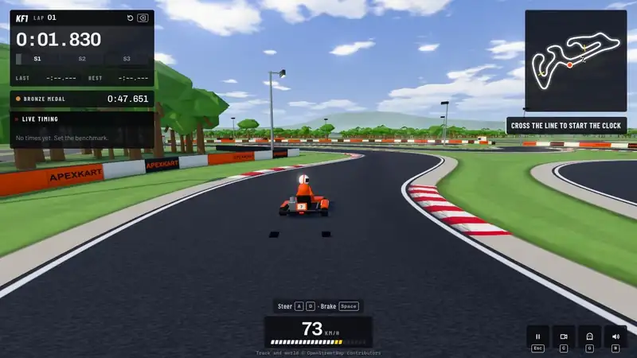
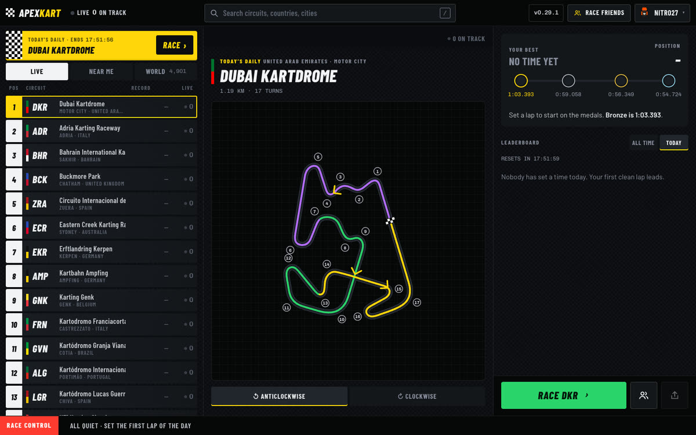
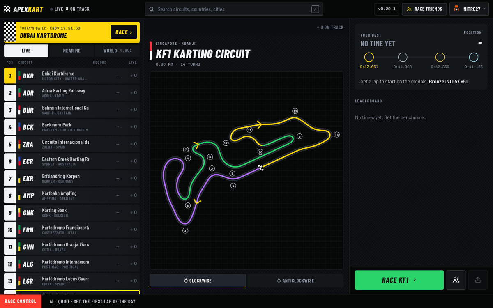
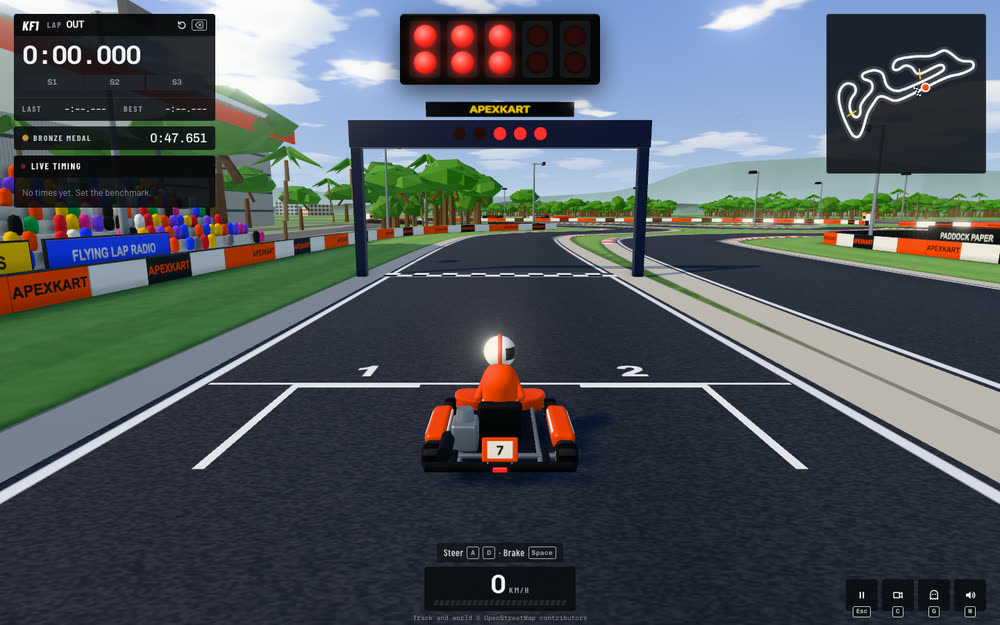
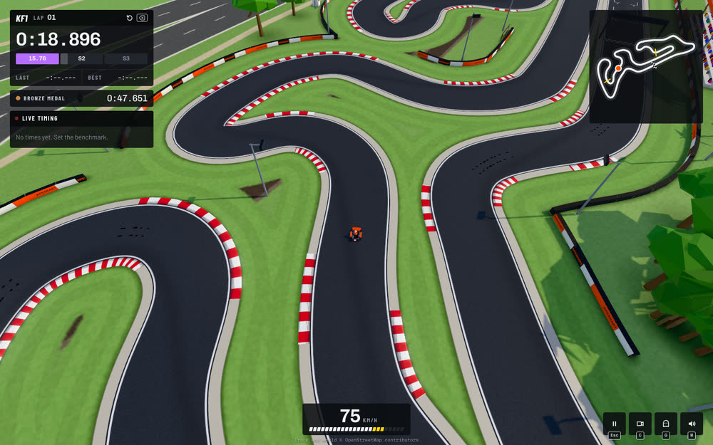
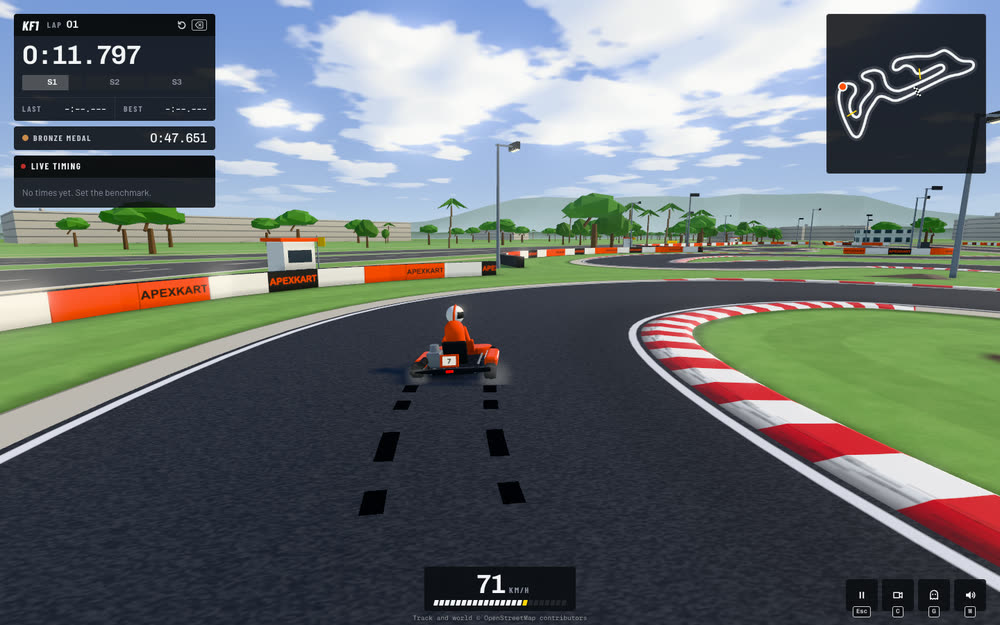
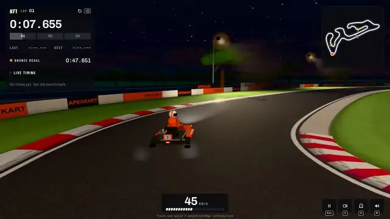
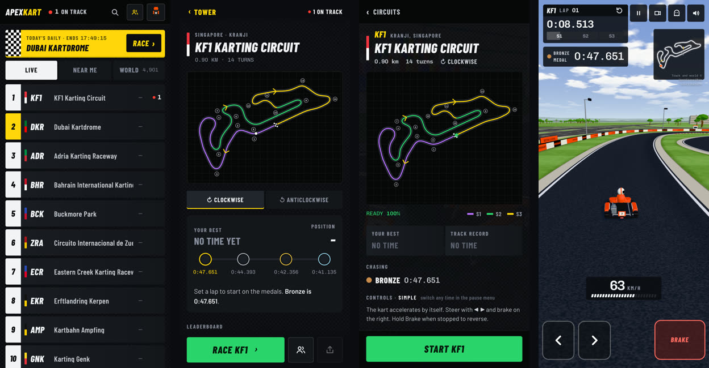
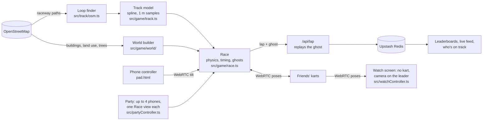

<div align="center">



# 🏁 ApexKart

**Race any real kart track on Earth, right in your browser.**

4,901 circuits in 143 countries, rebuilt from OpenStreetMap · F1-style live timing · ghosts · races with friends · day and night

<a href="https://apexkart-race.vercel.app"></a>


</div>

---

## Lights out in 30 seconds

1. **Pick a circuit** from the timing tower: the busiest right now, the nearest to you, or any of
   4,901 kart venues mapped on OpenStreetMap.
2. **Study it**: every layout is drawn with its sectors, numbered turns and the drivers on track.
3. **Hit Race.** The grid warms up for half a second, then five red lights.
4. **Lights out.** Chase your ghost, a medal, or the driver one place above you on the leaderboard.
5. **Cut the hairpin?** Lap invalid. The timing system follows the road you're actually on.

No account, no download. Your best laps and medals live on your device, and your times go on the
worldwide board.

<table>
<tr>
<td width="50%"><br><sub><b>The timing tower.</b> Circuits ranked like an F1 timing screen: Live, Near me, or the whole World.</sub></td>
<td width="50%"><br><sub><b>The circuit page.</b> Sector-coloured layout, your best lap, a medal ladder and the leaderboard.</sub></td>
</tr>
<tr>
<td><br><sub><b>Five red lights.</b> Then it's on.</sub></td>
<td><br><sub><b>TV camera.</b> One of four cameras. Kerbs sit where a real kart track puts them.</sub></td>
</tr>
</table>

## Every track is a real place

ApexKart doesn't ship a handful of hand-made levels. It reads the world.

- **The layout comes from OpenStreetMap.** Raceway paths are split at junctions and stitched into
  closed loops. A loop finder rejects routes that U-turn, so pit lanes can't sneak into a lap. The
  result is spline-smoothed, sampled every metre, and the start line lands on the longest straight.
- **So does everything around it.** Buildings rise to their mapped height, land use is painted into
  a crisp stylised ground, and trees fill the mapped woods and parks. Then come the tyre walls,
  floodlights, grandstand, pit building and marshal posts.
- **The details are deliberate.** Kerbs go on corner apexes and exits only, never on straights.
  Braking boards count down 3-2-1 before the big stops. There are grid boxes, a rubbered racing
  line, and clouds drifting over hills on the horizon.
- **OpenStreetMap wrong?** Hit **Fix the layout** to redraw it over satellite imagery. Corrected
  layouts are shared and get their own leaderboard.
- **Both directions.** Every circuit can be raced in reverse, with its own leaderboard.

<table>
<tr>
<td width="50%"></td>
<td width="50%"></td>
</tr>
<tr>
<td><sub>Skid marks that fade, tyre smoke, grass spray and sparks off the barriers.</sub></td>
<td><sub><b>Night racing.</b> Every race starts at the real time of day at the circuit. Or pick Day or Night.</sub></td>
</tr>
</table>

## Timing like the TV broadcast

- **Three sectors** go purple (fastest overall), green (your best) or yellow. Each chip flashes with
  the gap the moment you cross it.
- **A live gap** next to your lap time, against your best, the next medal, the driver above you or a
  rival. You choose in the pause menu.
- **Bronze, silver, gold, platinum.** Every circuit has a medal ladder, and you sit on it.
- **Fair laps.** Track limits are four wheels off. Lap progress follows the road you're actually on,
  so cutting across an infield voids the lap, and the server replays every lap's ghost before it
  reaches the leaderboard.
- **Instant restart.** Press Backspace and you're 150 m from the line at speed, ready for a flying lap.

## It feels like a kart

- **A synthesized engine** with no sound files at all: pitch follows speed, it pops when you lift
  off, and the clutch slips at the launch. Kerbs rumble, the grass crunches, walls thump.
- **Walls you can live with.** Brush one and you slide along it with most of your speed. Get
  properly stuck and a Reset button puts you back where you left the track.
- **Body motion.** The nose dips under braking and lifts under power, the body rolls in corners,
  the steering wheel turns, and the driver leans into the bend.
- **Vibration** on Android phones and gamepads, for kerbs, wall hits, the start lights and a new
  personal best.

## Race your friends

Create a room, send the link, and you're on a two-wide grid together (up to 8 karts, any number of
laps). It's peer-to-peer over WebRTC with a synchronised start, kart-to-kart contact, and a
slipstream when you tuck in behind someone. Positions and results are live. The details are in
[MULTIPLAYER.md](MULTIPLAYER.md).

## Your phone is the steering wheel

Press **Phone** on the laptop and scan the QR code. The phone becomes a wheel: hold it sideways and
tilt to steer, and press the screen to brake (Brake and Gas in Classic). It also has Start, Pause and
Reset, and buzzes when you hit something (on Android). It connects straight to the laptop over
WebRTC, using the same room-code signaling as multiplayer, so steering arrives in a few milliseconds.
Phones without a motion sensor get ◀ ▶ buttons instead. Pair one phone per laptop, and every player
in a multiplayer room can have their own. The details are in
[docs/phone-controller.md](docs/phone-controller.md).

## Party: split screen, a phone each

Press **Party** on a laptop or a TV and everyone scans the same QR code. Up to four phones join as
P1 to P4, each steering its own kart in its own view on the one screen: one above the other for two
players on a wide screen, a 2 × 2 grid for three or four (with three, the fourth corner is the live
standings). It is a real race, with a synchronised start, kart-to-kart contact, slipstream and a
classification at the end, because each view runs the same race code as an online room. Any phone
can start, pause and restart; if one drops out the race pauses until it is back, or the rest race on
without it. The details are in [docs/party.md](docs/party.md).

## Watch a race on the big screen

Open a room's **Watch link** (or type its code and press **Watch**) on a TV or a laptop that isn't
racing. It joins the room as a screen, not a driver: every player sends it their kart, and it shows the
race live with a timing tower, the map, and a camera that follows the leader (or anyone you pick, with
Chase, Far chase and an overhead TV camera). Between races it shows the room, the last results and a
QR code for joining. Players race on their own phones or laptops, so a room can be eight people
racing and everyone else watching. The details are in [docs/watch.md](docs/watch.md).

## Made for phones too



Portrait or landscape, touch controls with big targets, a camera that widens so you can see the next
corner, and graphics that pick their level once on your device so the race never stutters. The home
screen needs about 40 KB of JavaScript; the 3D engine only arrives when you pick a circuit.

## Controls

Two schemes, on keyboard, gamepad and touch. Switch any time from the pause menu.

- **Simple** (the default): the kart accelerates by itself. You brake and steer.
- **Classic**: throttle and brake yourself.

| Action | Simple | Classic |
| --- | --- | --- |
| Steer | `A D` / `← →` | `A D` / `← →` |
| Throttle | automatic | `W` / `↑` |
| Brake (and reverse when stopped) | `Space` / `S` / `↓` | `Space` / `S` / `↓` |
| Gamepad | stick or d-pad steers, LT or B brakes | RT or A throttle, LT or B brake, stick steers |
| Touch | ◀ ▶ on the left, Brake on the right | ◀ ▶ on the left, Brake and Gas on the right |
| Phone controller | tilt to steer, Brake on the right | tilt to steer, Brake on the left, Gas on the right |

In every scheme:

| Action | Keys |
| --- | --- |
| Reset onto track | `R` or the Reset button that appears when you're stuck (invalidates the lap), gamepad Y |
| Restart the lap (time trial) | `Backspace`, gamepad Select, or ↺ in the lap panel |
| Camera | `C` |
| Ghosts on/off | `G` |
| Mute | `M` |
| Pause | `Esc` / `P`, gamepad Start |

---

## Under the hood



| Piece | What it is |
| --- | --- |
| Rendering | Three.js r186 with a warm-up before the start, so no shader compiles mid-race. Clouds, soft shadows, floodlights, bloom and ambient occlusion on higher settings. |
| Physics | A fixed 120 Hz arcade kart model: bicycle-model steering, grip limits per surface, and walls that keep your momentum. |
| Audio | Web Audio synthesis only. There isn't a single sound file in the repo. |
| UI | **Pit Wall**: carbon black, Barlow Condensed and Chivo Mono, with the timing palette (yellow for actions, green for personal bests, purple for fastest, red for live). See [docs/pit-wall.md](docs/pit-wall.md). |
| Backend | Vercel serverless functions in `api/` and Upstash Redis. With no Redis configured, it falls back to memory. |
| Tracks | 22 featured circuits on five continents ship pre-baked with their surroundings. Every other venue's layouts are pre-stitched into map cells, so they open instantly too. |

The 22 featured circuits: KF1 (Singapore), South Garda (Lonato), Genk, PF International, Kerpen, the
Algarve, Adria, Zuera, Valencia, Franciacorta, Buckmore Park, Rye House, Ampfing, Paul Ricard,
Sepang, Dubai, Bahrain, Eastern Creek, Granja Viana, New Castle, Orlando and SH Karting.

## Run it yourself

```bash
npm install
npm run dev        # http://localhost:5173 (the /api routes run inside Vite too)
npm run build      # typecheck + production build
npm run tracks     # re-bake the featured circuits and their surroundings
npm run world      # re-collect every kart venue on OpenStreetMap into world.json
npm run venues     # pre-stitch every venue's layouts (or run the "Bake venue layouts" workflow)
```

In dev, the leaderboard lives in memory and resets when the server restarts. To add a featured
circuit, add it to `PRESETS` in `scripts/fetch-tracks.ts` and run `npm run tracks -- --new`
(existing circuits keep their ids, and so their leaderboards).

### The leaderboard API

`api/_lib/store.ts` uses Redis when `KV_REST_API_URL` / `KV_REST_API_TOKEN` (or the
`UPSTASH_REDIS_REST_*` equivalents) are set. Otherwise it falls back to memory.

| Endpoint | What it does |
| --- | --- |
| `GET /api/board?track&dir` | top 10 + who's on track (passing `pid` is a presence heartbeat) |
| `POST /api/lap` | submit a lap; keeps each driver's PB and ghost, and posts to the feed |
| `GET /api/ghost?track&dir&pid` | a driver's PB ghost |
| `GET /api/feed` | latest laps, every track record, live counts (CDN-cached 3 s) |
| `GET /api/track?id` | geometry for raced tracks, so shared links don't depend on Overpass |
| `GET/POST /api/layout` | community-corrected layouts (list / save) |
| `POST /api/room` | multiplayer rooms: lobby state, WebRTC signaling, pose relay |

Every lap is checked before it's kept: top speed, the ghost's duration against the lap time, the
ghost's path against the track, and a full replay of the ghost under the game's own lap rules
(continuous progress, track limits, sectors, minimum lap length). Submissions are rate-limited too.
It's much harder to cheat than it was, but the client is still trusted with its own physics.

### Deploying to Vercel

1. Import this repo in Vercel (framework preset **Vite**, already set in `vercel.json`).
2. Storage → Marketplace → **Upstash Redis** → connect it to the project. This injects the
   `KV_REST_API_*` env vars.
3. Deploy. The `api/*.ts` files become serverless functions automatically.

### Changelog and releases

Every change ships as its own release, listed in [CHANGELOG.md](CHANGELOG.md) and shown in the game
at **`#/changelog`** (tap the version number). Releases are annotated tags on `main` following
[semantic versioning](https://semver.org).

1. With every feature or fix that lands on `main`, add a line under `## [Unreleased]` in
   `CHANGELOG.md`. `main` deploys straight away, so Unreleased notes are already live.
2. To cut a release from an up-to-date `main`:
   ```bash
   npm run release -- minor          # or patch / major / an explicit 0.4.0
   git push origin main v0.4.0       # or pass --push to the release command
   ```
   This moves the Unreleased notes under the new version, bumps `package.json`, commits, and creates
   the tag with the release notes as its message.
3. `npm run build` checks that `package.json` matches the newest release in the changelog
   (`npm run version:check`).

## Data & attribution

- Track geometry and surroundings © [OpenStreetMap contributors](https://www.openstreetmap.org/copyright) (ODbL).
- Satellite imagery in the layout editor © Esri, Maxar, Earthstar Geographics. Check Esri's terms
  before any commercial use.
- Geocoding by Nominatim. Live track discovery goes through the public Overpass API, which is
  sometimes overloaded, so the app retries across mirrors.

<div align="center">
<br>
<a href="https://apexkart-race.vercel.app"><b>▶ Play ApexKart</b></a>
<br><br>
</div>
